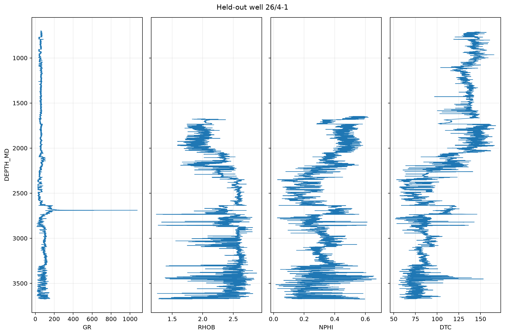
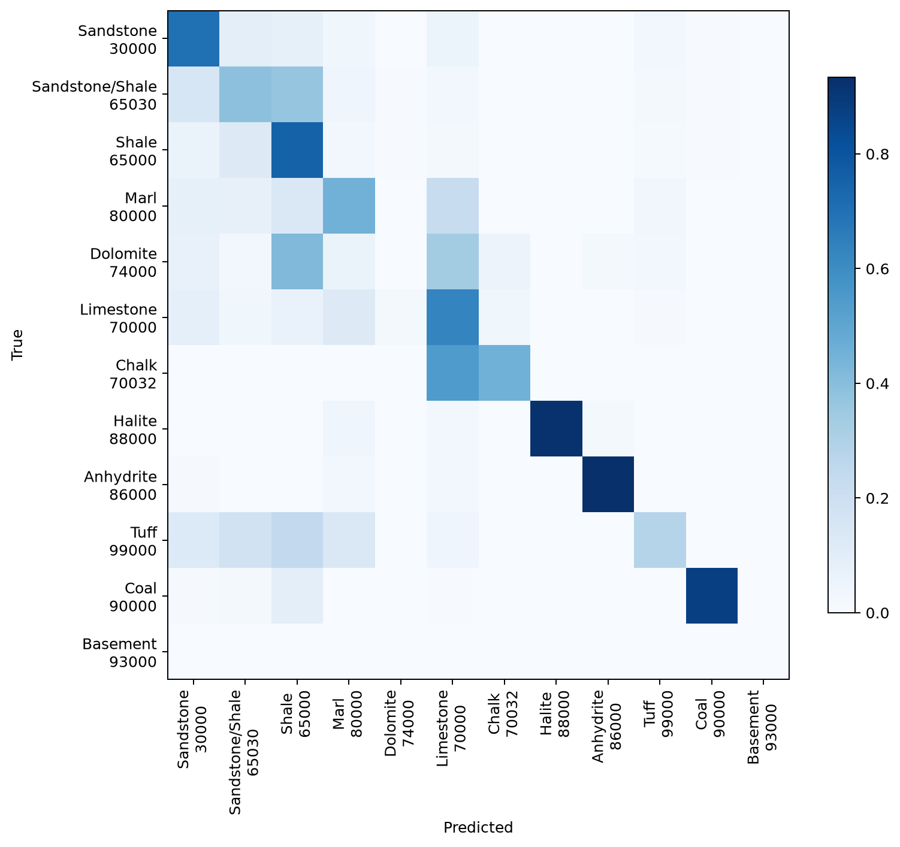
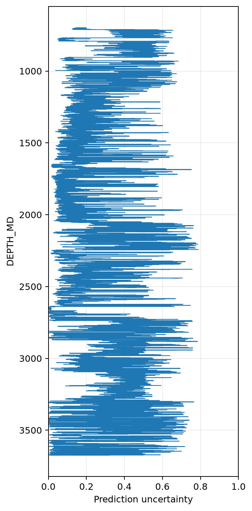

# FORCE 2020: QC, Lithology Prediction & Uncertainty Analysis

A reproducible petrophysics and machine-learning project that ingests **118 public Norwegian well logs**, audits data quality, predicts 12 lithology classes on unseen wells, and surfaces uncertain intervals for human review.



## What makes this different

This is not a single-well plotting notebook. It is a clean-room, tested workflow with:

- checksum-verified acquisition from a DOI-pinned Zenodo record;
- recursive LAS ingestion with `lasio` and explicit null normalization;
- QC across 118 heterogeneous wells and 2,337,639 depth samples;
- well-local gradients and rolling statistics that never cross well boundaries;
- **well-disjoint** training and evaluation to prevent adjacent-depth leakage;
- a class-balanced `HistGradientBoostingClassifier` baseline;
- accuracy, macro-F1, balanced accuracy, the official FORCE penalty score, per-class and per-well evidence;
- interpreter-confidence strata and prediction uncertainty; and
- a Streamlit dashboard that reads saved artifacts without retraining.

## Verified full-run results

A deterministic seed-42 run used 1,431,383 labelled samples. `GroupShuffleSplit` held out **24 complete wells / 286,870 samples**; no well appears in both partitions. Formation/group fields and human interpretation confidence were excluded from model inputs.

| Metric | Held-out result |
|---|---:|
| Accuracy | **69.28%** |
| Balanced accuracy | **58.07%** |
| Macro-F1 | **0.484** |
| FORCE penalty score | **−0.816** |

The model performs strongly on common shale and evaporite intervals, but rare and unseen classes remain difficult. Dolomite received zero recall in this split and basement had no held-out support. Those limitations are visible rather than hidden behind overall accuracy.



Reference-interpretation confidence also matters: high-confidence labels (level 1) reached 70.75% accuracy and a −0.782 FORCE score, while level-2 intervals reached 59.50% and −1.010. Confidence is used only for post-hoc analysis, never as a predictor.

## Architecture

```text
Zenodo archive (MD5 verified)
        |
        v
LAS ingestion + canonical schema     src/welllog/io.py
        |
        +--> QC summaries             src/welllog/qc.py
        |
        v
Well-local contextual features       src/welllog/features.py
        |
        v
Group-disjoint train/test split      src/welllog/model.py
        |
        v
Metrics + uncertainty + artifacts    src/welllog/evaluation.py
        |
        v
Artifact-only Streamlit review       app.py
```

## Repository layout

```text
.
├── app.py
├── data/
│   ├── README.md
│   └── registry.json
├── docs/
│   ├── METHODOLOGY.md
│   ├── RESUME_BULLETS.md
│   └── assets/
├── notebooks/
│   └── 01_force_lithology_workflow.ipynb
├── src/welllog/
├── tests/
└── pyproject.toml
```

## Dataset provenance

- **Dataset:** FORCE 2020 well-log and lithofacies dataset
- **DOI:** [10.5281/zenodo.4351156](https://doi.org/10.5281/zenodo.4351156)
- **Coverage:** 118 wells
- **Archive:** `LAS_files_Force_2020_all_wells_train_test_blind_hidden_final.zip`
- **Published size:** 169,785,172 bytes
- **Published and verified MD5:** `da0d72d5783a780ac71779453d9fbfbf`
- **Zenodo licence:** [CC BY 4.0](https://creativecommons.org/licenses/by/4.0/)

Raw data are intentionally excluded from Git and are not covered by this repository's MIT licence. See [`data/README.md`](data/README.md).

## Setup

Python 3.10 or newer is required.

```bash
git clone https://github.com/arnab-mitra/Well-Log-Data-Analysis.git
cd Well-Log-Data-Analysis
python -m venv .venv

# Windows PowerShell
.venv\Scripts\Activate.ps1

# macOS/Linux
source .venv/bin/activate

python -m pip install --upgrade pip
python -m pip install -e ".[all]"
```

For a smaller development install, use `python -m pip install -e ".[dev]"`.

## Reproduce the analysis

```bash
# Download and verify the archive
welllog download data/raw/force_2020_las.zip

# Extract the ZIP, then audit all LAS files
welllog qc data/raw/Force_2020_all_wells_train_test_blind_hidden_final

# Train and evaluate with complete wells held out
welllog train data/raw/Force_2020_all_wells_train_test_blind_hidden_final \
  --output artifacts/force-full-seed42 \
  --seed 42 \
  --test-size 0.2 \
  --max-iter 120
```

The run writes predictions with measured log curves, uncertainty, confusion and per-class/per-well metrics, QC tables, split well lists, and scalar metrics.

## Leakage controls

- **Group isolation:** complete wells are assigned to only one partition.
- **Boundary-safe context:** gradients and rolling windows reset for every well.
- **Inference-only inputs:** target, formation/group, and human label confidence are excluded.
- **Native missing-value handling:** no full-table imputer is fit before splitting.
- **Determinism:** split and model seeds are explicit and tested.
- **Artifact traceability:** train/test well lists and held-out predictions are persisted.

## Dashboard

```bash
streamlit run app.py
```

Point the sidebar at `artifacts/force-full-seed42`. Select any held-out well to inspect measured logs, actual versus predicted lithology, uncertainty, QC tables, and intervals exceeding a review threshold.



## Tests and CI

```bash
python -m ruff check app.py src tests
python -m compileall -q app.py src tests
python -m pytest
```

The synthetic tests cover checksum verification, LAS parsing, null handling, well-boundary isolation, feature leakage prevention, well-disjoint splitting, official FORCE scoring, deterministic training, artifacts, plots, CLI behavior, and dashboard helpers. CI deliberately avoids downloading the 170 MB archive.

## Limitations

- A single grouped split is sensitive to which wells are held out; grouped cross-validation would provide a more stable developmental estimate.
- Adjacent depths are autocorrelated, so 286,870 samples are not 286,870 independent geological observations.
- Rare lithologies are unstable; some may be absent from a held-out split.
- Centered windows are appropriate for offline interpretation, not real-time logging while drilling.
- Probabilities from the baseline model are not calibrated geological uncertainty.
- Norwegian offshore performance does not imply transfer to other basins, tool vintages, or acquisition programs.
- Predictions support geoscientist review; they do not replace petrophysical interpretation.

## Citation

> Bormann, P., Aursand, P., Dilib, F., Manral, S., & Dischington, P. (2020). *FORCE 2020 Well well log and lithofacies dataset for machine learning competition*. Zenodo. https://doi.org/10.5281/zenodo.4351156

See [`CITATION.cff`](CITATION.cff) for software citation metadata.

## Licence

New original code and documentation are released under the [MIT License](LICENSE). FORCE 2020 and other third-party materials retain their own terms and are excluded from that grant.
